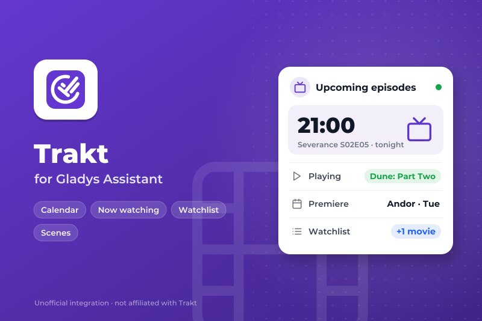
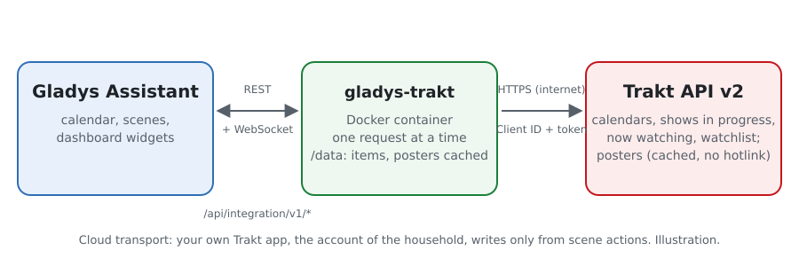
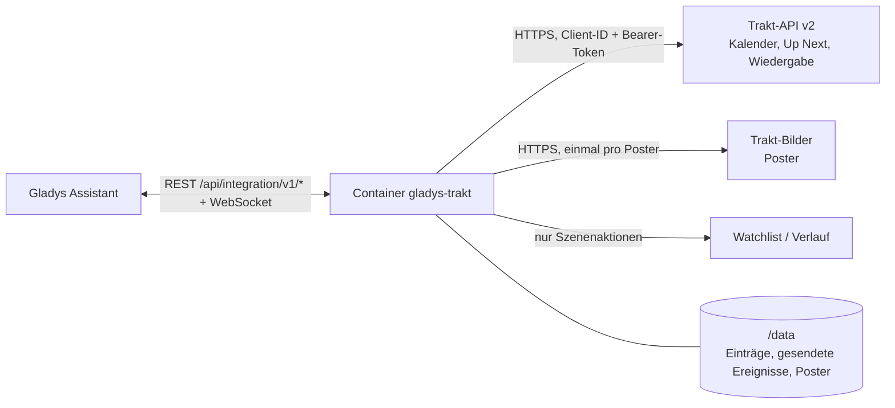
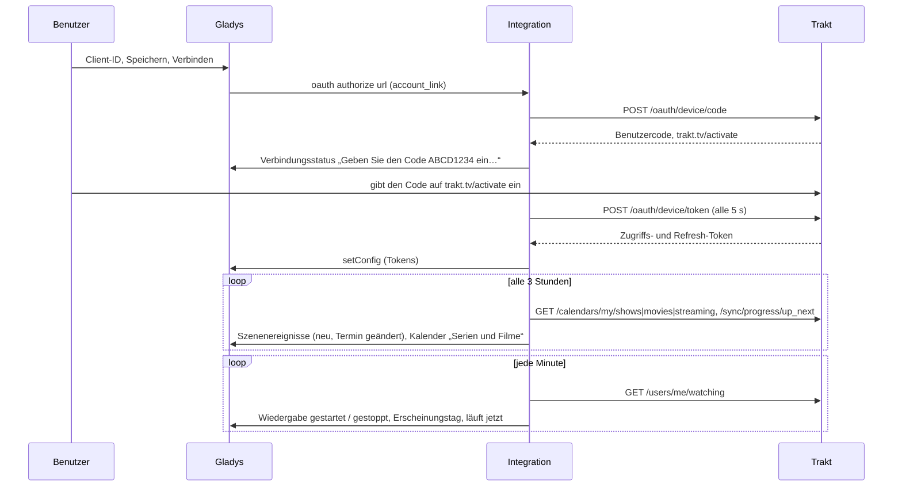
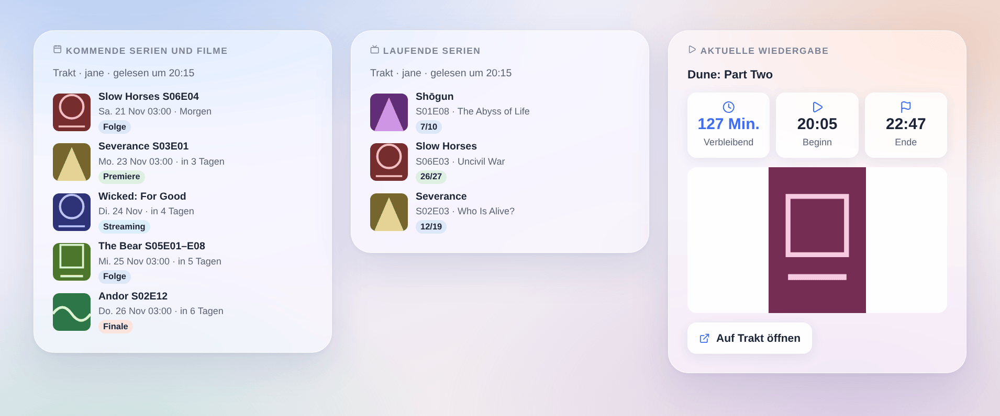

# Gladys Trakt

[English](README.md) · [Français](README.fr.md) · **Deutsch** · [Español](README.es.md)

[](LICENSE)
[](https://github.com/William-De71/gladys-trakt/releases)
[](https://github.com/William-De71/gladys-trakt/actions/workflows/release.yml)
[](https://gladysassistant.com)



Eine externe Integration für [Gladys Assistant](https://gladysassistant.com) und **[Trakt](https://trakt.tv)**: Die Folgen Ihrer Serien und die Starts Ihrer Watchlist landen im Kalender von Gladys, und Ihr Zuhause reagiert auf das, was Sie ansehen. Szenen wissen, wann eine Folge läuft und wann eine Wiedergabe auf Plex, Kodi oder Jellyfin startet oder endet; drei Dashboard-Widgets zeigen, was kommt, Ihre laufenden Serien und die aktuelle Wiedergabe.

Benutzerdokumentation: [English](docs/en.md) · [Français](docs/fr.md) · [Deutsch](docs/de.md) · [Español](docs/es.md).

> Gladys Trakt nutzt Trakt, ist aber weder von Trakt unterstützt noch zertifiziert. Community-Integration ohne Verbindung zu Trakt.

## Funktionen

- **Ihr Trakt-Konto** über die offizielle Trakt-API: Ihre eigene kostenlose API-App (nur ihre Client-ID) und eine Anmeldung per Code auf trakt.tv/activate über die Schaltfläche **Verbinden**. Die Tokens erneuern sich selbst.
- **Ein Kalender „Serien und Filme“** für jeden Benutzer, der die Integration unter „Meine Kalender“ aktiviert: Folgen zur Sendezeit (eine auf einmal veröffentlichte Staffel ist ein Termin), Filmstarts und Streaming-Starts als ganztägige Termine.
- **Was Sie ansehen**: Wiedergabe gestartet / gestoppt, an Trakt gemeldet von Plex, Kodi, Jellyfin, Emby, Infuse oder den Trakt-Apps.
- **Schreiben aus Szenen**: einen Film oder eine Serie zur Watchlist hinzufügen, einen Film oder die nächste Folge als gesehen markieren.
- **7 Szenenauslöser**, **3 Szenenaktionen**, **3 Dashboard-Widgets** und **2 Konfigurationsschaltflächen** (unten).
- **Poster**, einmal heruntergeladen und von der Integration aufbewahrt, wie Trakt es verlangt.
- Vier Sprachen überall: Englisch, Französisch, Deutsch, Spanisch.

## Funktionsweise





Trakt verlangt für jede Installation eine **eigene API-App**: Sie erstellen sie einmal auf trakt.tv (Settings → My Apps), und die Integration braucht nur ihre Client-ID. Verbinden startet den **Gerätecode-Ablauf**: Der auf trakt.tv/activate einzugebende Code erscheint im Verbindungsstatus. Das Zugriffstoken lebt 7 Tage und wird einen Tag vorher erneuert; die Refresh-Tokens sind nur einmal verwendbar, daher erneuert die Integration sie einzeln und speichert sie in der Konfiguration von Gladys, bevor sie sie nutzt.

Alle 3 Stunden (1 bis 12) fragt eine Abfrage die Kalender des Kontos (`/calendars/my/shows`, `movies`, `streaming`) in Abschnitten von 33 Tagen ab, von 7 Tagen zurück bis 30–90 Tage voraus, dann die laufenden Serien: etwa zehn Anfragen. „Aktuelle Wiedergabe“ fügt eine Anfrage pro Minute hinzu. Eine Anfrage nach der anderen; ein 429 pausiert alles, bis Trakt es wieder erlaubt. Eine fehlgeschlagene Abfrage entfernt nichts.

Was eine Abfrage ändert, löst die Szenenauslöser aus; dann werden die Kalender veröffentlicht und die Poster dessen zwischengespeichert, was ein Widget zeigen kann. Die erste Abfrage dient als Ausgangsbasis, ebenso die nach einer Szenenaktion, die auf Trakt geschrieben hat.



### Transport

Nur Cloud (`"transports": ["cloud"]`): Der Katalog zeigt das Cloud-Badge. Die Integration spricht nur mit `api.trakt.tv` und lädt die Poster von den Bildservern von Trakt. Ihre Client-ID und Ihre Tokens gehen nur an Trakt; Trakt erhält nur, was die Szenenaktionen schreiben (Watchlist, Verlauf). Es gibt keinen lokalen Weg, daher keine Schaltfläche „Lokale Verbindung bevorzugen“.

## Kalender und Termine

Keine Geräte: Gladys erlaubt nicht, dass eine Integration zugleich Kalender- und Geräte-Integration ist.

| Element       | Inhalt                                                                                                  |
| ------------- | ------------------------------------------------------------------------------------------------------- |
| Kalender      | „Serien und Filme“, einer pro Benutzer, privat, bis Sie ihn teilen                                      |
| Folge         | Termin mit Uhrzeit, zur Erstausstrahlung, so lang wie die Laufzeit: „Severance S02E05 – Trojan’s Horse“ |
| Ganze Staffel | Ein Termin für die auf einmal veröffentlichten Folgen: „Andor S02E01–E08“                               |
| Filmstart     | Ganztägiger Termin, Kino- oder Streaming-Start eines Films der Watchlist                                |
| Link          | Die Seite der Folge oder des Films auf trakt.tv                                                         |

Das Fenster reicht von 7 Tagen zurück bis 30, 60 oder 90 Tage voraus. Unter „Meine Kalender“ kann jeder Benutzer die Synchronisierung beenden oder den Kalender **mit dem Haushalt teilen**: Nur ein geteilter Kalender erreicht die Szenen des Haushalts und den eingebauten Auslöser „Ein Kalenderereignis steht bevor“. Das Trakt-Konto ist für alle Benutzer dasselbe.

## Szenenauslöser, Aktionen und Widgets



**Szenenauslöser** (einmal pro Übergang). Filter: Arten, Titel der Serie oder des Films.

- **Neu im Kalender**: Eine Folge oder ein Film ist in den bereits gelesenen Tagen aufgetaucht (verlängerte Serie, neuer Termin, auf trakt.tv hinzugefügter Titel), höchstens 10 pro Abfrage.
- **Erscheinungstag**: heute, morgen oder in einer Woche (Filter „Wann“), zur Stunde der Konfiguration.
- **Eine Folge läuft jetzt**: Ihre Sendezeit ist gerade verstrichen.
- **Termin geändert**: Tag oder Uhrzeit eines kommenden Eintrags hat sich geändert (`previous_date`, `previous_time`).
- **Wiedergabe gestartet** / **Wiedergabe gestoppt**: mit `finished` (Ende erreicht) und den gesehenen `minutes`.
- **Konto erneut verknüpfen**: Trakt lehnt die Anmeldung ab.

Die Variablen: `full_title`, `title`, `episode`, `episode_title`, `kind`, `kind_name`, `season`, `number`, `premiere`, `finale`, `date`, `time`, `date_text`, `days`, `network`, `url`, `text`.

**Szenenaktionen**: **nächste Folge oder Veröffentlichung** (mit einem fertigen Satz: „Severance S02E05 läuft morgen um 03:00.“), **zur Watchlist hinzufügen** (per Titel, IMDb-Kennung oder trakt.tv-Adresse) und **als gesehen markieren** (ein Film oder die nächste Folge einer laufenden Serie; nie zweimal innerhalb einer Stunde).

**Widgets**: **Kommende Serien und Filme** (Liste mit Tag, Uhrzeit, Badge und Poster), **Laufende Serien** (nächste Folge und Fortschritt) und **Aktuelle Wiedergabe** (Restzeit, Beginn, Ende, Poster).

**Konfigurationsschaltflächen**: jetzt neu lesen, Trakt-Konto trennen.

Beispiele:

- Wenn **die Wiedergabe startet** → das Wohnzimmer dimmen und die Rollläden schließen; wenn sie mit `finished` = true **stoppt** → Licht wieder an.
- Wenn **morgen eine Folge läuft** → `{{triggerEvent.data.text}}` per Telegram senden.
- Wenn **etwas Neues im Kalender erscheint** → `{{triggerEvent.data.full_title}}, {{triggerEvent.data.date_text}}` senden.

## Voraussetzungen

- Gladys Assistant **5.3.0** oder neuer (Kalender-Integrationen; Katalog-Schlüsselwörter von Gladys 5.3). Ältere Instanzen können die Integration nicht installieren.
- Ein Trakt-Konto (kostenlos genügt) und ein GitHub-Konto, das Trakt einmalig zum Erstellen einer API-App verlangt.
- Für „Aktuelle Wiedergabe“: ein Player, der an Trakt meldet.

## Installation

- **Aus dem Gladys-Store** (Integrationen → Externe Integrationen), mit einem Klick, sobald indexiert.
- **Über die Repository-URL**: `https://github.com/William-De71/gladys-trakt`.
- **Entwicklermodus**: Bauen Sie das Image lokal (`docker build -t gladys-trakt .`) und installieren Sie es aus Gladys.

## Konfiguration

| Feld                                    | Beschreibung                                                                           |
| --------------------------------------- | -------------------------------------------------------------------------------------- |
| Client ID                               | Ihrer Trakt-App (Settings → My Apps, Redirect-URI `urn:ietf:wg:oauth:2.0:oob`).        |
| Trakt-Konto                             | Die Schaltfläche Verbinden (Gerätecode auf trakt.tv/activate).                         |
| Was verfolgt wird                       | Folgen, Filmstarts, Streaming-Starts (standardmäßig alle drei).                        |
| Im Voraus gelesene Tage                 | 30, 60 (Standard) oder 90.                                                             |
| Specials behalten                       | Staffel 0 (standardmäßig aus).                                                         |
| Aktuelle Wiedergabe                     | Eine Anfrage pro Minute für die Wiedergabe-Auslöser und das Widget (standardmäßig an). |
| Abfrage des Kalenders                   | Alle 1, 3 (Standard), 6 oder 12 Stunden.                                               |
| Uhrzeit des Auslösers „Erscheinungstag“ | 0 bis 23, Ortszeit (standardmäßig 9).                                                  |
| Sprache der Szenentexte                 | Automatisch (die Sprache des Dashboards) oder eine feste Sprache.                      |

Die Tokens werden in der Konfiguration von Gladys gespeichert (sie folgen ihren Sicherungen). Trakt löscht eine 30 Tage ungenutzte App: Lassen Sie die Integration laufen. Drücken Sie dann unter **Meine Kalender** auf derselben Seite auf **Für mich aktivieren**: Jeder Benutzer, der den Kalender möchte, aktiviert die Integration für sich.

## Verwendung

1. Erstellen Sie Ihre Trakt-App, fügen Sie ihre Client-ID ein, speichern Sie, klicken Sie auf **Verbinden** und geben Sie den Code auf trakt.tv/activate ein.
2. Drücken Sie unter **Meine Kalender** auf **Für mich aktivieren**; teilen Sie den Kalender mit dem Haushalt, um ihn in Szenen zu nutzen.
3. Fügen Sie die Widgets einem Dashboard hinzu und erstellen Sie Szenen mit den Auslösern oben.

## Entwicklung

```bash
npm install
npm test                       # node --test, nie mit Netzwerkzugriff
npm run lint && npm run format:check
npx github:GladysAssistant/integration-store . --skip-image-check
scripts/build-cover.sh         # cover.jpg aus docs/assets/cover.svg
docs/illustrations/render.sh   # docs/assets/widgets.<Sprache>.png
node .github/scripts/release.mjs next
```

Lokal liest das SDK `GLADYS_HOST_API_URL`, `GLADYS_INTEGRATION_TOKEN` und `GLADYS_INTEGRATION_SELECTOR`, und `TZ` legt die Zeitzone der Tage fest; `DEBUG=gladys-integration-sdk` zeigt die SDK-Protokolle und prüft jeden Widget-Inhalt. Die Tests laufen gegen ein nachgebildetes Trakt hinter `fetch`, das der offiziellen API entspricht (`test/helpers.js`). Die Regeln des Projekts stehen in [CLAUDE.md](CLAUDE.md).

## Release-Prozess


Jeder Merge auf `main` startet die CI und berechnet dann die Version aus den [Conventional Commits](https://www.conventionalcommits.org/) seit dem letzten Tag: `feat` → Minor, `fix` / `perf` → Patch, `!` oder `BREAKING CHANGE` → Major (vor 1.0.0 ein Minor); `docs`, `chore`, `ci`, `test`, `style`, `refactor`, `build` allein veröffentlichen nichts. Der Changelog-Abschnitt wird erzeugt, der Tag gepusht, das Multi-Arch-Image gebaut, dann erhält `main` den Release-Commit, die GitHub Release wird erstellt und ein letzter Job prüft das öffentliche Image, den Store-Validator und das Topic.

- Der Titel des Pull Requests wird zum Squash-Commit und dann zur Changelog-Zeile: Schreiben Sie ihn auf Englisch, für den Benutzer (`pr-title.yml` prüft ihn). Bearbeiten Sie `CHANGELOG.md` nie von Hand.
- 1.0.0 ist eine Entscheidung: Actions → Release → Run workflow mit `release-as: 1.0.0`. `dry-run` zeigt Version und Notizen, ohne etwas zu veröffentlichen.
- **Geschützter Branch**: Rulesets verlangen einen Pull Request auf `main` und sperren die `v*`-Tags; nur der Maintainer und Deploy Keys kommen durch. Das Release pusht mit dem Deploy Key der Umgebung `release` (Secret `RELEASE_DEPLOY_KEY`, nur `main`): Ein Lauf von einem anderen Branch erhält ihn nie. `build.yml` und `github-release.yml` starten nicht bei einem Tag: Das Release ruft sie auf, oder starten Sie sie von Hand (Actions → Run workflow, mit `version` für das Image), um ein Release abzuschließen.
- Machen Sie nach der ersten Release das Paket auf `ghcr.io` öffentlich (Package settings → Change visibility), sonst kann Gladys es nicht herunterladen.

## Fehlerbehebung

Siehe [docs/de.md](docs/de.md#fehlerbehebung). Melden Sie Probleme mit den Versionen von Gladys und der Integration, Ihren Playern und den Zeilen des Protokoll-Tabs.

## Mitwirken

Issues und Pull Requests sind willkommen. Führen Sie vor einem Pull Request `npm run format:check && npm run lint && npm test` aus und lassen Sie alle externen IDs und gespeicherten Schlüssel unverändert (siehe [CLAUDE.md](CLAUDE.md)). Falsche Sendetermine werden an der Quelle korrigiert, auf Trakt oder TMDB.

## Sicherheit

Siehe [SECURITY.md](SECURITY.md): Melden Sie Schwachstellen vertraulich. Die Tokens sind interne Konfigurationsschlüssel und werden nie in die Protokolle oder nach `/data` geschrieben; die Integration läuft schreibgeschützt, ohne Root-Rechte, in ihrem Container und kontaktiert nur Trakt.

## Kommende Screenshots

Die Bilder oben sind Illustrationen, keine Screenshots. Echte Screenshots kommen nach `docs/assets/screenshots/` (PNG, 1280 × 800): `configuration.png`, `connect.png`, `calendar.png`, `scene.png`.

## Lizenz

[Apache License 2.0](LICENSE) — siehe auch [NOTICE](NOTICE). Gladys Trakt nutzt Trakt, ist aber weder von Trakt unterstützt noch zertifiziert; die Daten und Poster stammen von [Trakt](https://trakt.tv) und gehören ihren Eigentümern. Danke an die Dokumentation und das SDK von Gladys.
