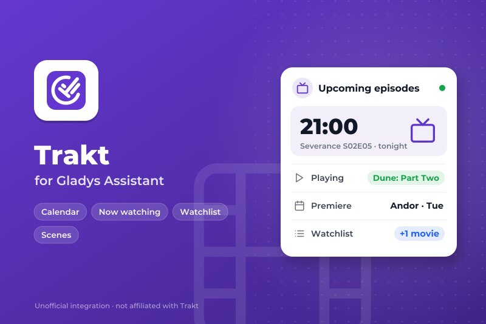
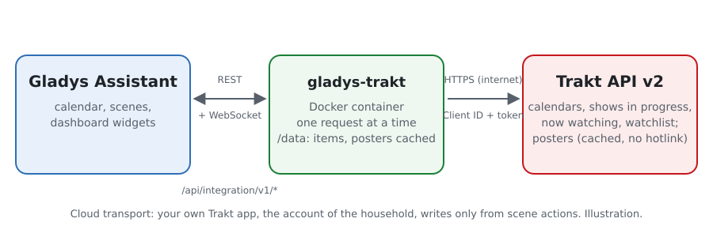
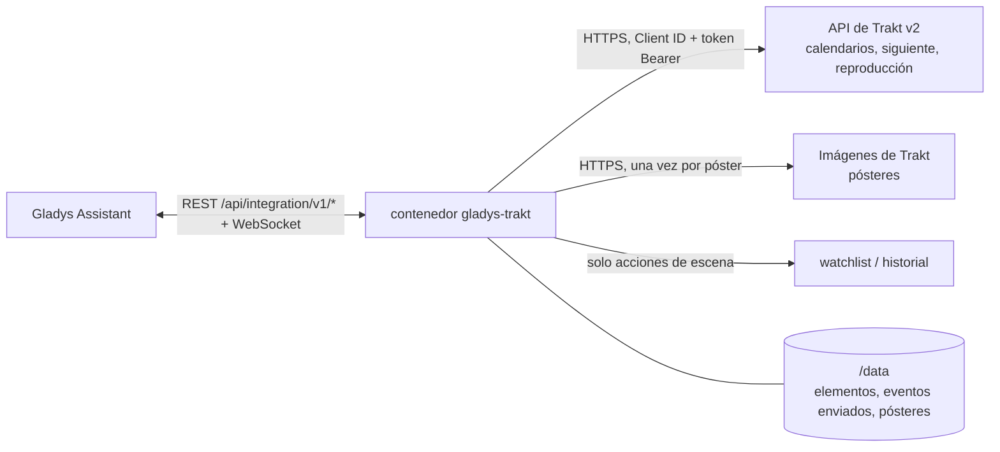
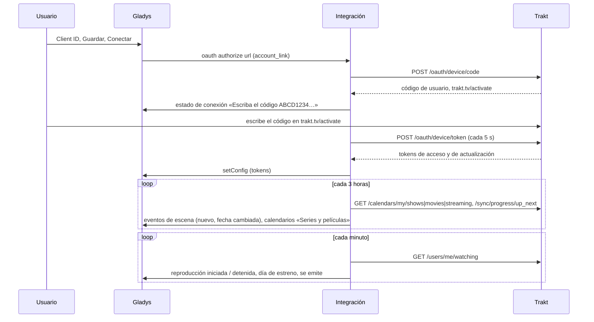
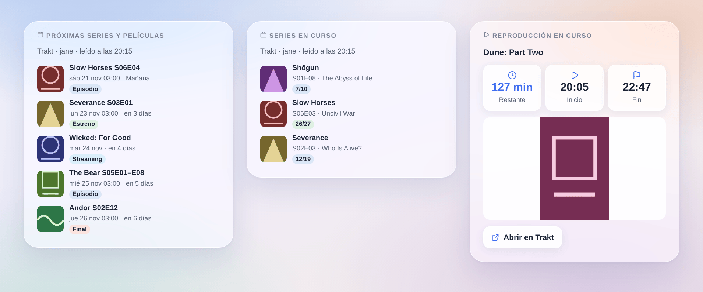

# Gladys Trakt

[English](README.md) · [Français](README.fr.md) · [Deutsch](README.de.md) · **Español**

[](LICENSE)
[](https://github.com/William-De71/gladys-trakt/releases)
[](https://github.com/William-De71/gladys-trakt/actions/workflows/release.yml)
[](https://gladysassistant.com)



Una integración externa de [Gladys Assistant](https://gladysassistant.com) para **[Trakt](https://trakt.tv)**: los episodios de sus series y los estrenos de su watchlist llegan al calendario de Gladys, y su casa reacciona a lo que ve. Las escenas saben cuándo se emite un episodio y cuándo empieza o termina una reproducción en Plex, Kodi o Jellyfin; tres widgets del panel muestran lo que viene, sus series en curso y la reproducción en curso.

Documentación de usuario: [English](docs/en.md) · [Français](docs/fr.md) · [Deutsch](docs/de.md) · [Español](docs/es.md).

> Gladys Trakt usa Trakt, pero no está respaldada ni certificada por Trakt. Integración comunitaria, sin vínculo con Trakt.

## Funcionalidades

- **Su cuenta de Trakt**, mediante la API oficial de Trakt: su propia app de API gratuita (solo su Client ID) y un inicio de sesión por código en trakt.tv/activate desde el botón **Conectar**. Los tokens se renuevan solos.
- **Un calendario «Series y películas»** para cada usuario que active la integración en «Mis calendarios»: episodios a su hora de emisión (una temporada publicada de golpe es un solo evento), estrenos de películas y estrenos en streaming como eventos de día completo.
- **Lo que ve**: reproducción iniciada / detenida, enviada a Trakt por Plex, Kodi, Jellyfin, Emby, Infuse o las apps de Trakt.
- **Escrituras desde escenas**: añadir una película o una serie a la watchlist, marcar una película o el próximo episodio como visto.
- **7 disparadores de escena**, **3 acciones de escena**, **3 widgets** y **2 botones de configuración** (abajo).
- **Pósteres**, descargados una vez y guardados por la integración, como exige Trakt.
- Cuatro idiomas en todas partes: inglés, francés, alemán, español.

## Funcionamiento





Trakt pide a cada instalación su **propia app de API**: la crea una vez en trakt.tv (Settings → My Apps), y la integración solo necesita su Client ID. Conectar inicia el **flujo por código de dispositivo**: el código que hay que escribir en trakt.tv/activate aparece en el estado de conexión. El token de acceso dura 7 días y se renueva la víspera; los tokens de actualización son de un solo uso, así que la integración los renueva uno a uno y los guarda en la configuración de Gladys antes de usarlos.

Cada 3 horas (1 a 12), una lectura consulta los calendarios de la cuenta (`/calendars/my/shows`, `movies`, `streaming`) en tramos de 33 días, de 7 días atrás a 30–90 días adelante, y luego las series en curso: unas diez peticiones. «Reproducción en curso» añade una petición por minuto. Una petición cada vez; un 429 lo pausa todo hasta que Trakt lo vuelva a permitir. Una lectura fallida no elimina nada.

Lo que cambia una lectura activa los disparadores de escena; después se publican los calendarios y se guardan en caché los pósteres de lo que un widget puede mostrar. La primera lectura sirve de referencia, igual que la que sigue a una acción de escena que escribió en Trakt.



### Transporte

Solo nube (`"transports": ["cloud"]`): el catálogo muestra la insignia de nube. La integración solo habla con `api.trakt.tv` y descarga los pósteres de los servidores de imágenes de Trakt. Su Client ID y sus tokens solo van a Trakt; Trakt solo recibe lo que escriben las acciones de escena (watchlist, historial). No hay vía local, así que no hay botón «Preferir la conexión local».

## Calendario y eventos

Sin dispositivos: Gladys no permite que una integración sea a la vez de calendario y de dispositivos.

| Elemento            | Contenido                                                                                               |
| ------------------- | ------------------------------------------------------------------------------------------------------- |
| Calendario          | «Series y películas», uno por usuario, privado hasta que lo comparta                                    |
| Episodio            | Evento con hora, en la primera emisión, tan largo como su duración: «Severance S02E05 – Trojan’s Horse» |
| Temporada completa  | Un solo evento para los episodios publicados de golpe: «Andor S02E01–E08»                               |
| Estreno de película | Evento de día completo, estreno en cines o en streaming de una película de la watchlist                 |
| Enlace              | La página del episodio o de la película en trakt.tv                                                     |

La ventana va de 7 días atrás a 30, 60 o 90 días adelante. En «Mis calendarios», cada usuario puede dejar de sincronizar el calendario o **compartirlo con el hogar**: solo un calendario compartido llega a las escenas del hogar y al disparador nativo «Se acerca un evento del calendario». La cuenta de Trakt es la misma para todos los usuarios.

## Disparadores, acciones de escena y widgets



**Disparadores de escena** (una vez por transición). Filtros: tipos, título de la serie o de la película.

- **Nuevo en el calendario**: ha aparecido un episodio o una película en los días ya leídos (serie renovada, nueva fecha, título añadido en trakt.tv), 10 como máximo por lectura.
- **Día de estreno**: hoy, mañana o dentro de una semana (filtro «Cuándo»), a la hora de la configuración.
- **Se emite un episodio**: su hora de emisión acaba de pasar.
- **Fecha cambiada**: ha cambiado el día o la hora de un elemento próximo (`previous_date`, `previous_time`).
- **Reproducción iniciada** / **Reproducción detenida**: con `finished` (final alcanzado) y los `minutes` vistos.
- **Cuenta por vincular**: Trakt rechaza la sesión.

Las variables: `full_title`, `title`, `episode`, `episode_title`, `kind`, `kind_name`, `season`, `number`, `premiere`, `finale`, `date`, `time`, `date_text`, `days`, `network`, `url`, `text`.

**Acciones de escena**: **próximo episodio o estreno** (con una frase lista: «Severance S02E05 se emite mañana a las 03:00.»), **añadir a la watchlist** (por título, identificador de IMDb o dirección de trakt.tv) y **marcar como visto** (una película, o el próximo episodio de una serie en curso; nunca dos veces en una hora).

**Widgets**: **Próximas series y películas** (lista con día, hora, insignia y póster), **Series en curso** (próximo episodio y progreso) y **Reproducción en curso** (tiempo restante, inicio, fin, póster).

**Botones de configuración**: leer de nuevo ahora, desconectar la cuenta de Trakt.

Ejemplos:

- Cuando **empieza la reproducción** → bajar la luz del salón y cerrar las persianas; cuando **se detiene** con `finished` = true → volver a encender.
- Cuando **un episodio se emite mañana** → enviar `{{triggerEvent.data.text}}` por Telegram.
- Cuando **aparece algo nuevo en el calendario** → enviar `{{triggerEvent.data.full_title}}, {{triggerEvent.data.date_text}}`.

## Requisitos

- Gladys Assistant **5.3.0** o posterior (integraciones de calendario; palabras clave del catálogo de Gladys 5.3). Las instancias más antiguas no pueden instalar la integración.
- Una cuenta de Trakt (la gratuita basta) y una cuenta de GitHub, que Trakt pide una vez para crear una app de API.
- Para «Reproducción en curso»: un reproductor que envíe sus reproducciones a Trakt.

## Instalación

- **Desde la tienda de Gladys** (Integraciones → Integraciones externas), en un clic, una vez indexada.
- **Desde la URL del repositorio**: `https://github.com/William-De71/gladys-trakt`.
- **Modo desarrollador**: construya la imagen en local (`docker build -t gladys-trakt .`) e instálela desde Gladys.

## Configuración

| Campo                                | Descripción                                                                                       |
| ------------------------------------ | ------------------------------------------------------------------------------------------------- |
| Client ID                            | De su app de Trakt (Settings → My Apps, redirect URI `urn:ietf:wg:oauth:2.0:oob`).                |
| Cuenta de Trakt                      | El botón Conectar (código de dispositivo en trakt.tv/activate).                                   |
| Qué seguir                           | Episodios, estrenos de películas, estrenos en streaming (los tres por defecto).                   |
| Días leídos por adelantado           | 30, 60 (por defecto) o 90.                                                                        |
| Conservar los especiales             | Temporada 0 (desactivado por defecto).                                                            |
| Reproducción en curso                | Una petición por minuto para los disparadores y el widget de reproducción (activado por defecto). |
| Lectura del calendario               | Cada 1, 3 (por defecto), 6 o 12 horas.                                                            |
| Hora del disparador «día de estreno» | 0 a 23, hora local (9 por defecto).                                                               |
| Idioma de los textos de las escenas  | Automático (el idioma del panel), o un idioma fijo.                                               |

Los tokens se guardan en la configuración de Gladys (siguen sus copias de seguridad). Trakt elimina una app sin uso durante 30 días: deje la integración en marcha. Después, en **Mis calendarios**, en la misma página, pulse **Activar para mí**: cada usuario que quiera el calendario activa la integración para sí mismo.

## Uso

1. Cree su app de Trakt, pegue su Client ID, guarde, pulse **Conectar** y escriba el código en trakt.tv/activate.
2. En **Mis calendarios**, pulse **Activar para mí**; comparta el calendario con el hogar para usarlo en escenas.
3. Añada los widgets a un panel y cree escenas con los disparadores de arriba.

## Desarrollo

```bash
npm install
npm test                       # node --test, nunca usa la red
npm run lint && npm run format:check
npx github:GladysAssistant/integration-store . --skip-image-check
scripts/build-cover.sh         # cover.jpg desde docs/assets/cover.svg
docs/illustrations/render.sh   # docs/assets/widgets.<idioma>.png
node .github/scripts/release.mjs next
```

En local, el SDK lee `GLADYS_HOST_API_URL`, `GLADYS_INTEGRATION_TOKEN` y `GLADYS_INTEGRATION_SELECTOR`, y `TZ` fija la zona horaria de los días; `DEBUG=gladys-integration-sdk` muestra los registros del SDK y comprueba cada contenido de widget. Las pruebas se ejecutan contra un Trakt simulado detrás de `fetch`, calcado de la API oficial (`test/helpers.js`). Las reglas del proyecto están en [CLAUDE.md](CLAUDE.md).

## Proceso de publicación


Cada fusión en `main` lanza la CI y luego calcula la versión a partir de los [Conventional Commits](https://www.conventionalcommits.org/) desde la última etiqueta: `feat` → menor, `fix` / `perf` → parche, `!` o `BREAKING CHANGE` → mayor (una menor antes de 1.0.0); `docs`, `chore`, `ci`, `test`, `style`, `refactor`, `build` solos no publican nada. Se genera la sección del changelog, se envía la etiqueta, se construye la imagen multiarquitectura, `main` recibe el commit de publicación, se crea la GitHub Release y un último trabajo comprueba la imagen pública, el validador de la tienda y el topic.

- El título de la pull request pasa a ser el commit squash y luego la línea del changelog: escríbalo en inglés, para el usuario (`pr-title.yml` lo comprueba). No edite nunca `CHANGELOG.md` a mano.
- La 1.0.0 es una decisión: Actions → Release → Run workflow con `release-as: 1.0.0`. `dry-run` muestra la versión y las notas sin publicar nada.
- **Rama protegida**: unos rulesets exigen una pull request en `main` y bloquean las etiquetas `v*`; solo pasan el mantenedor y las deploy keys. La publicación hace push con la deploy key del entorno `release` (secreto `RELEASE_DEPLOY_KEY`, solo `main`): una ejecución lanzada desde otra rama nunca la obtiene. `build.yml` y `github-release.yml` no arrancan con una etiqueta: la publicación los llama, o lánzelos a mano (Actions → Run workflow, con `version` para la imagen) para terminar una publicación.
- Tras la primera publicación, haga público el paquete de `ghcr.io` (Package settings → Change visibility); si no, Gladys no puede descargarlo.

## Solución de problemas

Vea [docs/es.md](docs/es.md#solución-de-problemas). Informe de los problemas con las versiones de Gladys y de la integración, sus reproductores y las líneas de la pestaña Registros.

## Contribuir

Las issues y pull requests son bienvenidas. Ejecute `npm run format:check && npm run lint && npm test` antes de abrir una pull request y mantenga sin cambios todos los identificadores externos y claves guardadas (vea [CLAUDE.md](CLAUDE.md)). Una fecha de emisión errónea se corrige en el origen, en Trakt o TMDB.

## Seguridad

Vea [SECURITY.md](SECURITY.md): informe de las vulnerabilidades en privado. Los tokens son claves internas de configuración, nunca escritas en los registros ni en `/data`; la integración se ejecuta en solo lectura, sin derechos de root, en su contenedor, y solo contacta con Trakt.

## Capturas de pantalla pendientes

Las imágenes de arriba son ilustraciones, no capturas de pantalla. Las capturas reales irán a `docs/assets/screenshots/` (PNG, 1280 × 800): `configuration.png`, `connect.png`, `calendar.png`, `scene.png`.

## Licencia

[Apache License 2.0](LICENSE) — vea también [NOTICE](NOTICE). Gladys Trakt usa Trakt, pero no está respaldada ni certificada por Trakt; los datos y los pósteres vienen de [Trakt](https://trakt.tv) y pertenecen a sus propietarios. Gracias a la documentación y al SDK de Gladys.
