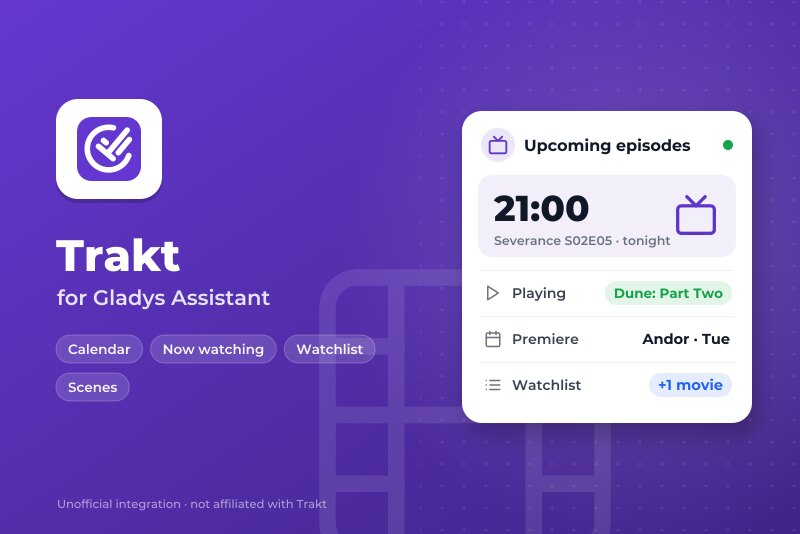
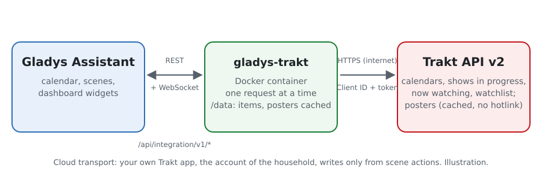
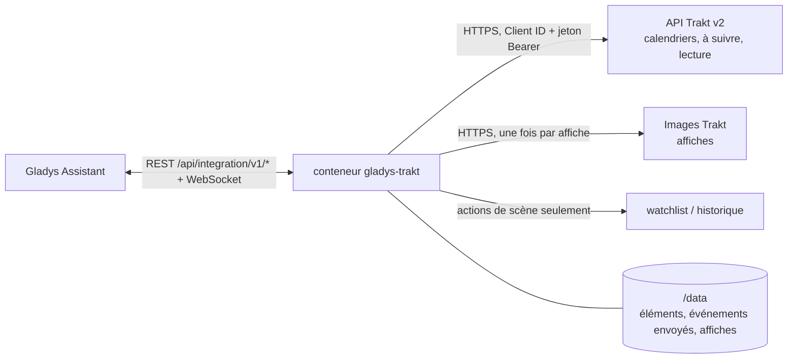
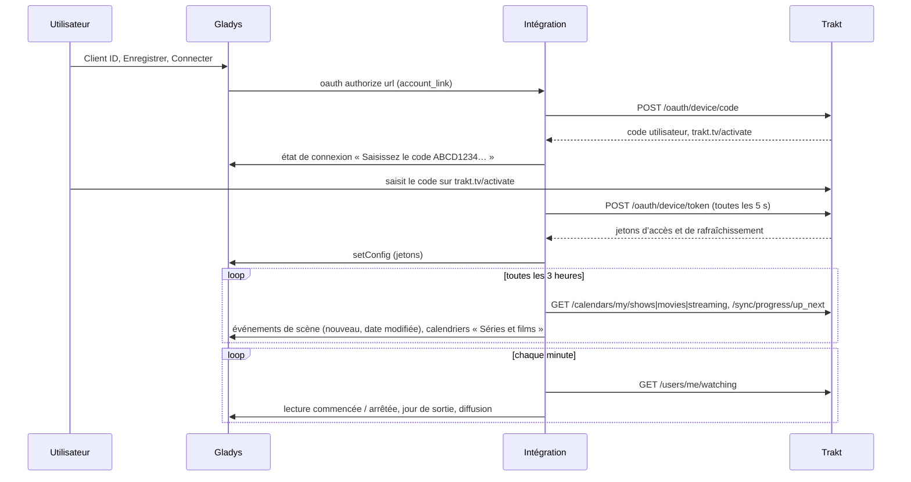
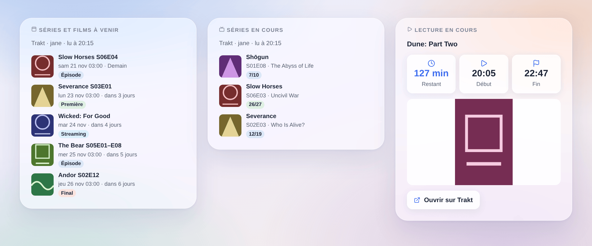

# Gladys Trakt

[English](README.md) · **Français** · [Deutsch](README.de.md) · [Español](README.es.md)

[](LICENSE)
[](https://github.com/William-De71/gladys-trakt/releases)
[](https://github.com/William-De71/gladys-trakt/actions/workflows/release.yml)
[](https://gladysassistant.com)



Une intégration externe de [Gladys Assistant](https://gladysassistant.com) pour **[Trakt](https://trakt.tv)** : les épisodes de vos séries et les sorties de votre watchlist arrivent dans le calendrier de Gladys, et la maison réagit à ce que vous regardez. Les scènes savent quand un épisode est diffusé et quand une lecture commence ou s’arrête sur Plex, Kodi ou Jellyfin ; trois widgets du tableau de bord montrent ce qui arrive, vos séries en cours et la lecture en cours.

Documentation utilisateur : [English](docs/en.md) · [Français](docs/fr.md) · [Deutsch](docs/de.md) · [Español](docs/es.md).

> Gladys Trakt utilise Trakt mais n’est ni approuvée ni certifiée par Trakt. Intégration communautaire, sans lien avec Trakt.

## Fonctionnalités

- **Votre compte Trakt**, par l’API officielle de Trakt : votre propre app d’API gratuite (son seul Client ID) et une connexion par code sur trakt.tv/activate depuis le bouton **Connecter**. Les jetons se renouvellent seuls.
- **Un calendrier « Séries et films »** pour chaque utilisateur qui active l’intégration dans « Mes calendriers » : épisodes à leur heure de diffusion (une saison publiée d’un coup forme un seul événement), sorties de films et sorties en streaming sur la journée.
- **Ce que vous regardez** : lecture commencée / arrêtée, transmise à Trakt par Plex, Kodi, Jellyfin, Emby, Infuse ou les applis Trakt.
- **Écritures depuis les scènes** : ajouter un film ou une série à la watchlist, marquer un film ou le prochain épisode comme vu.
- **7 déclencheurs de scène**, **3 actions de scène**, **3 widgets** et **2 boutons de configuration** (ci-dessous).
- **Affiches**, téléchargées une fois et gardées par l’intégration, comme Trakt l’exige.
- Quatre langues partout : anglais, français, allemand, espagnol.

## Fonctionnement





Trakt demande à chaque installation sa **propre app d’API** : vous la créez une fois sur trakt.tv (Settings → My Apps), et l’intégration n’a besoin que de son Client ID. Connecter lance le **flux par code d’appareil** : le code à saisir sur trakt.tv/activate apparaît dans l’état de connexion. Le jeton d’accès vit 7 jours et se renouvelle la veille ; les jetons de rafraîchissement sont à usage unique, donc l’intégration les renouvelle un par un et les enregistre dans la configuration de Gladys avant de s’en servir.

Toutes les 3 heures (1 à 12), une lecture interroge les calendriers du compte (`/calendars/my/shows`, `movies`, `streaming`) par tranches de 33 jours, de 7 jours en arrière à 30–90 jours en avant, puis les séries en cours : une dizaine de requêtes. « Lecture en cours » ajoute une requête par minute. Une requête à la fois ; un 429 suspend tout jusqu’à ce que Trakt le permette de nouveau. Une lecture ratée ne retire rien.

Ce qu’une lecture change lance les déclencheurs de scène, puis les calendriers sont publiés et les affiches de ce qu’un widget peut montrer sont mises en cache. La première lecture sert de référence, comme celle qui suit une action de scène qui a écrit sur Trakt.



### Transport

Cloud uniquement (`"transports": ["cloud"]`) : le catalogue affiche le badge cloud. L’intégration ne parle qu’à `api.trakt.tv` et télécharge les affiches depuis les serveurs d’images de Trakt. Votre Client ID et vos jetons ne vont qu’à Trakt ; Trakt ne reçoit que ce qu’écrivent les actions de scène (watchlist, historique). Il n’y a pas de chemin local, donc pas de bouton « Préférer la connexion locale ».

## Calendrier et événements

Pas d’appareils : Gladys ne permet pas qu’une intégration soit à la fois de calendrier et d’appareils.

| Élément         | Contenu                                                                                                     |
| --------------- | ----------------------------------------------------------------------------------------------------------- |
| Calendrier      | « Séries et films », un par utilisateur, privé tant que vous ne le partagez pas                             |
| Épisode         | Événement horaire, à la première diffusion, aussi long que sa durée : « Severance S02E05 – Trojan’s Horse » |
| Saison complète | Un seul événement pour les épisodes publiés d’un coup : « Andor S02E01–E08 »                                |
| Sortie de film  | Événement sur la journée, sortie en salle ou en streaming d’un film de la watchlist                         |
| Lien            | La page de l’épisode ou du film sur trakt.tv                                                                |

La fenêtre va de 7 jours en arrière à 30, 60 ou 90 jours en avant. Dans « Mes calendriers », chaque utilisateur peut arrêter de synchroniser le calendrier ou **le partager avec le foyer** : seul un calendrier partagé atteint les scènes du foyer et le déclencheur natif « Un événement du calendrier arrive ». Le compte Trakt est le même pour tous les utilisateurs.

## Déclencheurs, actions de scène et widgets



**Déclencheurs de scène** (une fois par transition). Filtres : types, titre de la série ou du film.

- **Nouveau dans le calendrier** : un épisode ou un film est apparu dans les jours déjà lus (série renouvelée, nouvelle date, titre ajouté sur trakt.tv), 10 au plus par lecture.
- **Jour de sortie** : aujourd’hui, demain ou dans une semaine (filtre « Quand »), à l’heure de la configuration.
- **Un épisode est diffusé** : son heure de diffusion vient de passer.
- **Date modifiée** : le jour ou l’heure d’un élément à venir a changé (`previous_date`, `previous_time`).
- **Lecture commencée** / **Lecture arrêtée** : avec `finished` (fin atteinte) et les `minutes` regardées.
- **Compte à relier** : Trakt refuse la connexion.

Les variables : `full_title`, `title`, `episode`, `episode_title`, `kind`, `kind_name`, `season`, `number`, `premiere`, `finale`, `date`, `time`, `date_text`, `days`, `network`, `url`, `text`.

**Actions de scène** : **prochain épisode ou sortie** (avec une phrase prête : « Severance S02E05 est diffusé demain à 03:00. »), **ajouter à la watchlist** (par titre, identifiant IMDb ou adresse trakt.tv) et **marquer comme vu** (un film, ou le prochain épisode d’une série en cours ; jamais deux fois en une heure).

**Widgets** : **Séries et films à venir** (liste avec jour, heure, pastille et affiche), **Séries en cours** (prochain épisode et progression) et **Lecture en cours** (temps restant, début, fin, affiche).

**Boutons de configuration** : relire maintenant, déconnecter le compte Trakt.

Exemples :

- Quand **la lecture commence** → baisser la lumière du salon et fermer les volets ; quand elle **s’arrête** avec `finished` = true → rallumer.
- Quand **un épisode est diffusé demain** → envoyer `{{triggerEvent.data.text}}` sur Telegram.
- Quand **quelque chose de nouveau apparaît dans le calendrier** → envoyer `{{triggerEvent.data.full_title}}, {{triggerEvent.data.date_text}}`.

## Prérequis

- Gladys Assistant **5.3.0** ou plus récent (intégrations de calendrier ; mots-clés du catalogue de Gladys 5.3). Les instances plus anciennes ne peuvent pas installer l’intégration.
- Un compte Trakt (le gratuit suffit) et un compte GitHub, que Trakt demande une fois pour créer une app d’API.
- Pour « Lecture en cours » : un lecteur qui envoie ses lectures à Trakt.

## Installation

- **Depuis le store de Gladys** (Intégrations → Intégrations externes), en un clic, une fois indexée.
- **Depuis l’URL du dépôt** : `https://github.com/William-De71/gladys-trakt`.
- **Mode développeur** : construisez l’image en local (`docker build -t gladys-trakt .`) et installez-la depuis Gladys.

## Configuration

| Champ                                   | Description                                                                               |
| --------------------------------------- | ----------------------------------------------------------------------------------------- |
| Client ID                               | De votre app Trakt (Settings → My Apps, redirect URI `urn:ietf:wg:oauth:2.0:oob`).        |
| Compte Trakt                            | Le bouton Connecter (code d’appareil sur trakt.tv/activate).                              |
| Ce qu’il faut suivre                    | Épisodes, sorties de films, sorties en streaming (les trois par défaut).                  |
| Jours lus à l’avance                    | 30, 60 (par défaut) ou 90.                                                                |
| Garder les épisodes spéciaux            | Saison 0 (désactivé par défaut).                                                          |
| Lecture en cours                        | Une requête par minute pour les déclencheurs et le widget de lecture (activé par défaut). |
| Lecture du calendrier                   | Toutes les 1, 3 (par défaut), 6 ou 12 heures.                                             |
| Heure du déclencheur « jour de sortie » | 0 à 23, heure locale (9 par défaut).                                                      |
| Langue des textes des scènes            | Automatique (la langue du tableau de bord), ou une langue fixe.                           |

Les jetons sont gardés dans la configuration de Gladys (ils suivent ses sauvegardes). Trakt supprime une app inutilisée pendant 30 jours : laissez l’intégration tourner. Ensuite, dans **Mes calendriers** sur la même page, appuyez sur **Activer pour moi** : chaque utilisateur qui veut le calendrier active l’intégration pour lui-même.

## Utilisation

1. Créez votre app Trakt, collez son Client ID, enregistrez, cliquez sur **Connecter** et saisissez le code sur trakt.tv/activate.
2. Dans **Mes calendriers**, appuyez sur **Activer pour moi** ; partagez le calendrier avec le foyer pour l’utiliser dans les scènes.
3. Ajoutez les widgets à un tableau de bord, et créez des scènes avec les déclencheurs ci-dessus.

## Développement

```bash
npm install
npm test                       # node --test, ne touche jamais le réseau
npm run lint && npm run format:check
npx github:GladysAssistant/integration-store . --skip-image-check
scripts/build-cover.sh         # cover.jpg depuis docs/assets/cover.svg
docs/illustrations/render.sh   # docs/assets/widgets.<langue>.png
node .github/scripts/release.mjs next
```

En local, le SDK lit `GLADYS_HOST_API_URL`, `GLADYS_INTEGRATION_TOKEN` et `GLADYS_INTEGRATION_SELECTOR`, et `TZ` règle le fuseau des jours ; `DEBUG=gladys-integration-sdk` affiche les journaux du SDK et vérifie chaque contenu de widget. Les tests tournent contre un faux Trakt derrière `fetch`, calqué sur l’API officielle (`test/helpers.js`). Les règles du projet sont dans [CLAUDE.md](CLAUDE.md).

## Processus de release


Chaque fusion sur `main` lance la CI, puis calcule la version à partir des [Conventional Commits](https://www.conventionalcommits.org/) depuis le dernier tag : `feat` → mineure, `fix` / `perf` → correctif, `!` ou `BREAKING CHANGE` → majeure (une mineure avant 1.0.0) ; `docs`, `chore`, `ci`, `test`, `style`, `refactor`, `build` seuls ne publient rien. La section du changelog est générée, le tag poussé, l’image multi-architecture construite, puis `main` reçoit le commit de release, la GitHub Release est créée et un dernier job vérifie l’image publique, le validateur du store et le topic.

- Le titre de la pull request devient le commit squash, puis la ligne du changelog : écrivez-le en anglais, pour l’utilisateur (`pr-title.yml` le vérifie). Ne modifiez jamais `CHANGELOG.md` à la main.
- La 1.0.0 est une décision : Actions → Release → Run workflow avec `release-as: 1.0.0`. `dry-run` affiche la version et les notes sans rien publier.
- **Branche protégée** : la release pousse son commit sur `main` avec `GITHUB_TOKEN`. Avec un ruleset sur `main`, ajoutez GitHub Actions à sa liste de contournement (ou poussez via une GitHub App), sinon le job de publication échoue avec des instructions.
- Après la première release, rendez public le paquet `ghcr.io` (Package settings → Change visibility), sinon Gladys ne peut pas le télécharger.

## Dépannage

Voir [docs/fr.md](docs/fr.md#dépannage). Signalez les problèmes avec les versions de Gladys et de l’intégration, vos lecteurs, et les lignes de l’onglet Journaux.

## Contribuer

Les issues et pull requests sont les bienvenues. Lancez `npm run format:check && npm run lint && npm test` avant d’ouvrir une pull request, et gardez inchangés tous les identifiants externes et clés stockées (voir [CLAUDE.md](CLAUDE.md)). Une date de diffusion fausse se corrige à la source, sur Trakt ou TMDB.

## Sécurité

Voir [SECURITY.md](SECURITY.md) : signalez les vulnérabilités en privé. Les jetons sont des clés internes de configuration, jamais écrites dans les journaux ni dans `/data` ; l’intégration tourne en lecture seule, sans droits root, dans son conteneur, et ne contacte que Trakt.

## Captures d’écran à venir

Les images ci-dessus sont des illustrations, pas des captures d’écran. Les vraies captures iront dans `docs/assets/screenshots/` (PNG, 1280 × 800) : `configuration.png`, `connect.png`, `calendar.png`, `scene.png`.

## Licence

[Apache License 2.0](LICENSE) — voir aussi [NOTICE](NOTICE). Gladys Trakt utilise Trakt mais n’est ni approuvée ni certifiée par Trakt ; les données et les affiches viennent de [Trakt](https://trakt.tv) et appartiennent à leurs propriétaires. Merci à la documentation et au SDK de Gladys.
