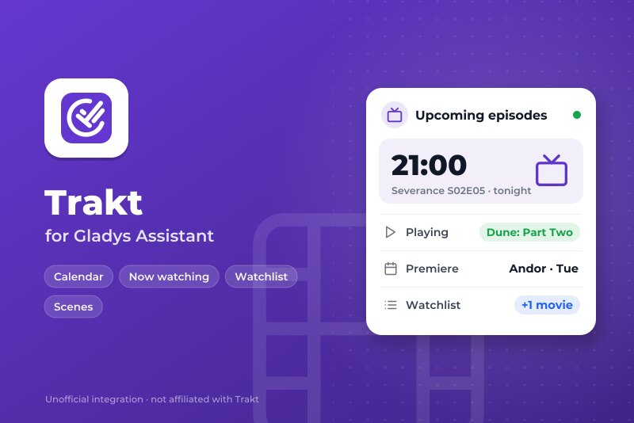
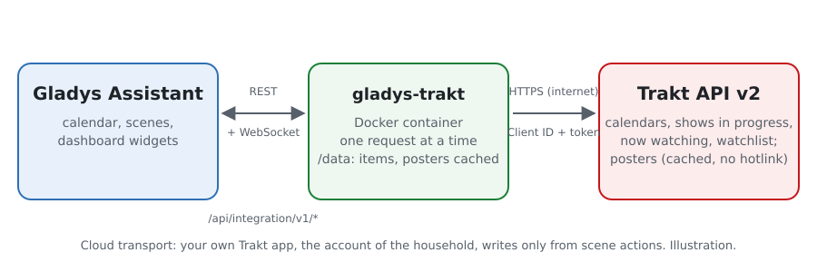
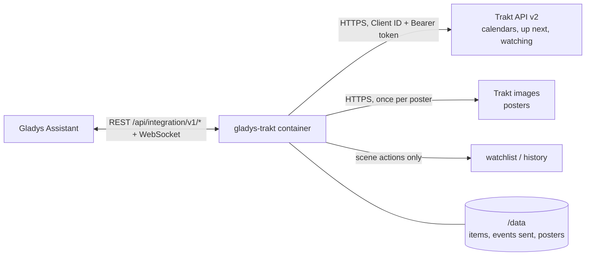
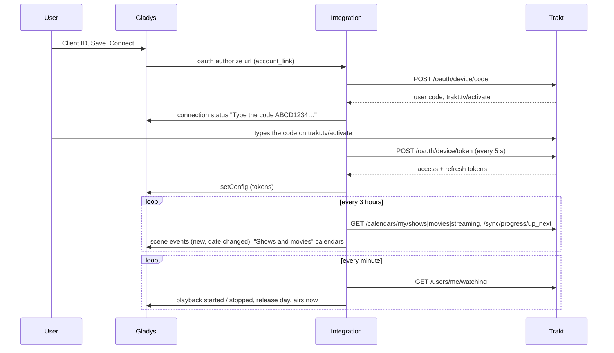
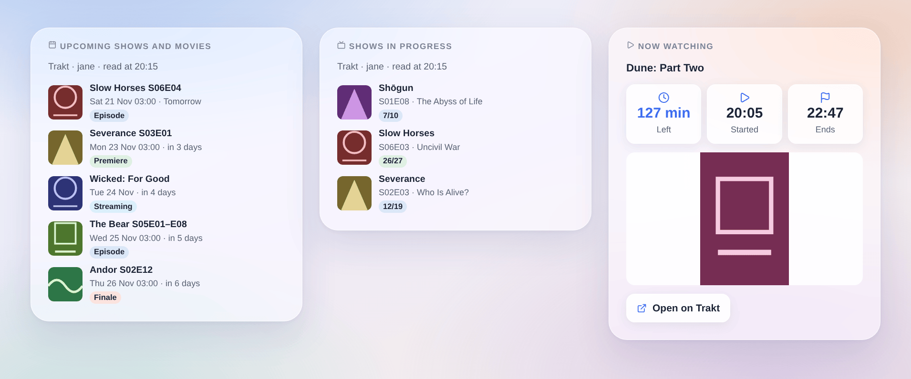

# Gladys Trakt

**English** · [Français](README.fr.md) · [Deutsch](README.de.md) · [Español](README.es.md)

[](LICENSE)
[](https://github.com/William-De71/gladys-trakt/releases)
[](https://github.com/William-De71/gladys-trakt/actions/workflows/release.yml)
[](https://gladysassistant.com)



A [Gladys Assistant](https://gladysassistant.com) external integration for **[Trakt](https://trakt.tv)**: the episodes of your shows and the releases of your watchlist land in the Gladys calendar, and your home reacts to what you watch. Scenes know when an episode airs and when playback starts or stops on Plex, Kodi or Jellyfin; three dashboard widgets show what is coming, your shows in progress and what is playing.

User documentation: [English](docs/en.md) · [Français](docs/fr.md) · [Deutsch](docs/de.md) · [Español](docs/es.md).

> Gladys Trakt uses Trakt but is not endorsed or certified by Trakt. Community integration, not affiliated with Trakt.

## Features

- **Your Trakt account**, through the official Trakt API: your own free API app (its Client ID only) and a sign-in by code on trakt.tv/activate from the **Connect** button. The tokens renew themselves.
- **A "Shows and movies" calendar** for every user who enables the integration in "My calendars": episodes at their airing time (a season dropped at once is one event), movie releases and streaming releases as all-day events.
- **What you watch**: playback started / stopped, reported to Trakt by Plex, Kodi, Jellyfin, Emby, Infuse or the Trakt apps.
- **Writes from scenes**: add a movie or a show to the watchlist, mark a movie or the next episode as watched.
- **7 scene triggers**, **3 scene actions**, **3 dashboard widgets** and **2 configuration buttons** (below).
- **Posters**, downloaded once and kept by the integration, as Trakt requires.
- Four languages everywhere: English, French, German, Spanish.

## How it works





Trakt asks every installation for its **own API app**: you create it once on trakt.tv (Settings → My Apps), and the integration only needs its Client ID. Connect starts the **device code flow**: the code to type on trakt.tv/activate appears in the connection status. The access token lives 7 days and is renewed a day before; the refresh tokens are single-use, so the integration renews them one at a time and stores them in the Gladys configuration before using them.

Every 3 hours (1 to 12), a reading asks the calendars of the account (`/calendars/my/shows`, `movies`, `streaming`) by chunks of 33 days, from 7 days back to 30–90 days ahead, then the shows in progress: about ten requests. "Now watching" adds one request a minute. One request at a time; a 429 pauses everything until Trakt allows it again. A failed reading removes nothing.

What a reading changes fires the scene triggers, then the calendars are published and the posters of what a widget can show are cached. The first reading is a baseline, and so is the one that follows a scene action that wrote to Trakt.



### Transport

Cloud only (`"transports": ["cloud"]`): the catalog shows the cloud badge. The integration only talks to `api.trakt.tv` and downloads the posters from the Trakt image servers. Your Client ID and tokens only go to Trakt; Trakt only receives what the scene actions write (watchlist, history). There is no local path, hence no "Prefer the local connection" button.

## Calendar and events

No devices: Gladys does not let one integration be both a calendar and a device integration.

| Item          | Content                                                                                       |
| ------------- | --------------------------------------------------------------------------------------------- |
| Calendar      | "Shows and movies" (FR "Séries et films"), one per user, private until you share it           |
| Episode       | Timed event, at the first airing, as long as the runtime: "Severance S02E05 – Trojan's Horse" |
| Whole season  | One event for the episodes released at once: "Andor S02E01–E08"                               |
| Movie release | All-day event, theatrical or streaming release of a movie of the watchlist                    |
| Link          | The page of the episode or the movie on trakt.tv                                              |

The window goes from 7 days back to 30, 60 or 90 days ahead. In "My calendars", each user can stop synchronizing the calendar or **share it with the household**: only a shared calendar reaches the scenes of the household and the native "Calendar event is coming" trigger. The Trakt account is the same for every user.

## Scene triggers, actions and widgets



**Scene triggers** (once per transition). Filters: kinds, title of the show or the movie.

- **New in the calendar**: an episode or a movie appeared in the days already read (renewed show, new date, title added on trakt.tv), 10 at most per reading.
- **Release day**: today, tomorrow or in a week (filter "When"), at the hour of the configuration.
- **An episode airs now**: its airing time just passed.
- **Date changed**: the day or the time of something to come changed (`previous_date`, `previous_time`).
- **Playback started** / **Playback stopped**: with `finished` (end reached) and `minutes` watched.
- **Account to link again**: Trakt refuses the sign-in.

The variables: `full_title`, `title`, `episode`, `episode_title`, `kind`, `kind_name`, `season`, `number`, `premiere`, `finale`, `date`, `time`, `date_text`, `days`, `network`, `url`, `text`.

**Scene actions**: **next episode or release** (with a ready-made sentence: "Severance S02E05 airs tomorrow at 03:00."), **add to the watchlist** (by title, IMDb id or trakt.tv address) and **mark as watched** (a movie, or the next episode of a show in progress; never twice within an hour).

**Widgets**: **Upcoming shows and movies** (list with day, time, badge and poster), **Shows in progress** (next episode and progress) and **Now watching** (time left, start, end, poster).

**Configuration buttons**: read again now, disconnect the Trakt account.

Examples:

- When **playback starts** → dim the living room and close the shutters; when it **stops** with `finished` = true → lights back on.
- When **an episode airs tomorrow** → send `{{triggerEvent.data.text}}` on Telegram.
- When **something new appears in the calendar** → send `{{triggerEvent.data.full_title}}, {{triggerEvent.data.date_text}}`.

## Requirements

- Gladys Assistant **5.3.0** or later (calendar integrations; catalog keywords of Gladys 5.3). Older instances cannot install the integration.
- A Trakt account (free is enough) and a GitHub account, which Trakt asks for once to create an API app.
- For "Now watching": a player that scrobbles to Trakt.

## Installation

- **From the Gladys store** (Integrations → External integrations), in one click, once indexed.
- **From the repository URL**: `https://github.com/William-De71/gladys-trakt`.
- **Developer mode**: build the image locally (`docker build -t gladys-trakt .`) and install it from Gladys.

## Configuration

| Field                             | Description                                                                       |
| --------------------------------- | --------------------------------------------------------------------------------- |
| Client ID                         | Of your Trakt app (Settings → My Apps, redirect URI `urn:ietf:wg:oauth:2.0:oob`). |
| Trakt account                     | The Connect button (device code on trakt.tv/activate).                            |
| What to follow                    | Episodes, movie releases, streaming releases (all three by default).              |
| Days read ahead                   | 30, 60 (default) or 90.                                                           |
| Keep the specials                 | Season 0 (off by default).                                                        |
| Now watching                      | One request a minute for the playback triggers and widget (on by default).        |
| Reading of the calendar           | Every 1, 3 (default), 6 or 12 hours.                                              |
| Hour of the "release day" trigger | 0 to 23, local time (9 by default).                                               |
| Language of the scene texts       | Automatic (the language of the dashboard), or a fixed language.                   |

The tokens are kept in the configuration of Gladys (they follow its backups). Trakt deletes an app unused for 30 days: keep the integration running. Then, in **My calendars** on the same page, press **Enable for me**: each user who wants the calendar enables the integration for themselves.

## Usage

1. Create your Trakt app, paste its Client ID, save, click **Connect** and type the code on trakt.tv/activate.
2. In **My calendars**, press **Enable for me**; share the calendar with the household to use it in scenes.
3. Add the widgets to a dashboard, and create scenes with the triggers above.

## Development

```bash
npm install
npm test                       # node --test, never touches the network
npm run lint && npm run format:check
npx github:GladysAssistant/integration-store . --skip-image-check
scripts/build-cover.sh         # cover.jpg from docs/assets/cover.svg
docs/illustrations/render.sh   # docs/assets/widgets.<lang>.png
node .github/scripts/release.mjs next
```

Locally, the SDK reads `GLADYS_HOST_API_URL`, `GLADYS_INTEGRATION_TOKEN` and `GLADYS_INTEGRATION_SELECTOR`, and `TZ` sets the timezone of the days; `DEBUG=gladys-integration-sdk` prints the SDK logs and checks every widget content. The tests run against a fake Trakt behind `fetch`, shaped like the official API (`test/helpers.js`). The rules of the project are in [CLAUDE.md](CLAUDE.md).

## Release process


Every merge on `main` runs the CI, then computes the version from the [Conventional Commits](https://www.conventionalcommits.org/) since the last tag: `feat` → minor, `fix` / `perf` → patch, `!` or `BREAKING CHANGE` → major (a minor before 1.0.0); `docs`, `chore`, `ci`, `test`, `style`, `refactor`, `build` alone publish nothing. The changelog section is generated, the tag pushed, the multi-arch image built, then `main` receives the release commit, the GitHub Release is created and a last job checks the public image, the store validator and the topic.

- The pull request title becomes the squash commit, then the changelog line: write it in English, for the user (`pr-title.yml` checks it). Never edit `CHANGELOG.md` by hand.
- 1.0.0 is a decision: Actions → Release → Run workflow with `release-as: 1.0.0`. `dry-run` shows the version and the notes without publishing anything.
- **Protected branch**: the release pushes its commit to `main` with `GITHUB_TOKEN`. With a ruleset on `main`, add GitHub Actions to its bypass list (or push through a GitHub App), otherwise the publish job fails with instructions.
- After the first release, make the `ghcr.io` package public (Package settings → Change visibility), otherwise Gladys cannot download it.

## Troubleshooting

See [docs/en.md](docs/en.md#troubleshooting). Report problems with the Gladys and integration versions, your players, and the lines of the Logs tab.

## Contributing

Issues and pull requests are welcome. Run `npm run format:check && npm run lint && npm test` before opening a pull request, and keep every external id and stored key unchanged (see [CLAUDE.md](CLAUDE.md)). Wrong airing dates are fixed at the source, on Trakt or TMDB.

## Security

See [SECURITY.md](SECURITY.md): report vulnerabilities privately. The tokens are internal configuration keys, never written to the logs nor to `/data`; the integration runs read-only, without root rights, in its container, and only contacts Trakt.

## Screenshots to come

The images above are illustrations, not screenshots. Real screenshots will go to `docs/assets/screenshots/` (PNG, 1280 × 800): `configuration.png`, `connect.png`, `calendar.png`, `scene.png`.

## License

[Apache License 2.0](LICENSE) — see also [NOTICE](NOTICE). Gladys Trakt uses Trakt but is not endorsed or certified by Trakt; the data and the posters come from [Trakt](https://trakt.tv) and belong to their owners. Thanks to the documentation and the SDK of Gladys.
