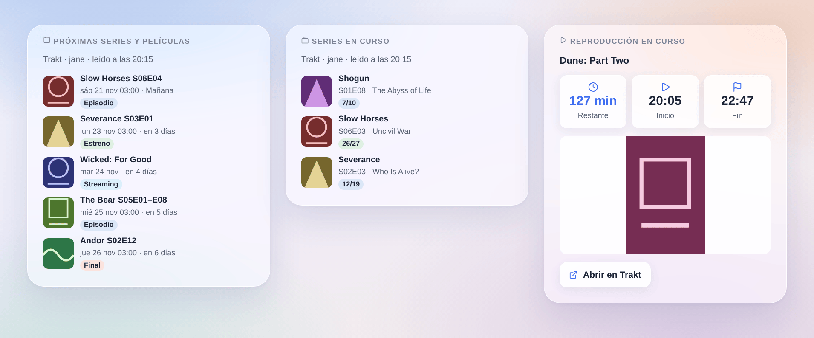

# Trakt

## Presentación

Esta integración lleva su cuenta de **Trakt** a Gladys. Los episodios de las series que sigue y los estrenos de las películas de su watchlist llegan a un **calendario «Series y películas»** para cada usuario que activa la integración. Las escenas pueden reaccionar el día en que se emite un episodio (o la víspera, o una semana antes), en el minuto mismo de su emisión, cuando cambia una fecha, y cuando **empieza o deja de ver** algo en Plex, Kodi, Jellyfin, Infuse o las apps de Trakt. Las acciones de escena añaden un título a su watchlist o lo marcan como visto, y tres widgets del panel muestran lo que viene, sus series en curso y la reproducción en curso, con los pósteres.

Todo viene de la [API oficial de Trakt](https://developer.trakt.tv), con su propia app de Trakt gratuita. Gladys Trakt usa Trakt, pero no está respaldada ni certificada por Trakt.

## Requisitos

- Gladys Assistant **5.3.0** o posterior (integraciones de calendario).
- Acceso a Internet.
- Una cuenta de [Trakt](https://trakt.tv) (la gratuita basta) y una cuenta de GitHub, que Trakt pide una vez para dejarle crear una app de API.
- Para «Reproducción en curso»: un reproductor que envíe sus reproducciones a Trakt (Plex, Kodi, Jellyfin, Emby, Infuse, las apps de Trakt…), o check-ins.

## Configuración

1. En trakt.tv, abra **Settings → My Apps** (la primera vez, Trakt le pide vincular una cuenta de GitHub verificada) y cree una app: cualquier nombre, por ejemplo «Gladys», redirect URI `urn:ietf:wg:oauth:2.0:oob`. Copie su **Client ID**. No hace falta Client Secret.
2. En Gladys, pegue el Client ID en la configuración de la integración y **guarde**.
3. Pulse **Conectar**: se abre la página de activación de Trakt. Inicie sesión en Trakt y escriba el código mostrado en el estado de conexión de la página de configuración. Unos segundos después, el estado indica «Vinculada a <su nombre de Trakt>».
4. En **Mis calendarios**, en la misma página, pulse **Activar para mí**. Cada usuario que quiera el calendario activa la integración para sí mismo; la cuenta de Trakt es la misma para todos.

Trakt elimina una app sin uso durante 30 días: deje la integración en marcha. Una app en desarrollo (la opción por defecto) basta para usted y hasta 16 personas invitadas.

| Campo                                | Descripción                                                                                             |
| ------------------------------------ | ------------------------------------------------------------------------------------------------------- |
| Client ID                            | El Client ID de su app de Trakt (64 caracteres). Identifica la app; no es una contraseña.               |
| Cuenta de Trakt                      | El botón Conectar: vincula la cuenta mediante un código escrito en trakt.tv/activate.                   |
| Qué seguir                           | Episodios de series, estrenos de películas y estrenos de películas en streaming (los tres por defecto). |
| Días leídos por adelantado           | 30, 60 (por defecto) o 90 días.                                                                         |
| Conservar los especiales             | Episodios de la «temporada 0» (extras, making-of). Desactivado por defecto.                             |
| Reproducción en curso                | Pregunta a Trakt cada minuto qué está viendo la cuenta. Activado por defecto.                           |
| Lectura del calendario               | Cada hora, cada 3 horas (por defecto), 6 o 12 horas.                                                    |
| Hora del disparador «día de estreno» | De 0 a 23, hora local (9 por defecto).                                                                  |
| Idioma de los textos de las escenas  | Idioma de las frases listas y de los mensajes de los botones. Automático: el idioma del panel.          |

Los botones **Leer de nuevo ahora** y **Desconectar la cuenta de Trakt** están al final de la configuración. Tras una desconexión, revoque también la app en sus ajustes de Trakt (Connected apps).

## Uso

### Calendario

Cada usuario recibe un calendario llamado «Series y películas»:

- un **episodio** es un evento a su hora de emisión (convertida a la zona horaria de Gladys), tan largo como su duración: «Severance S02E05 – Trojan’s Horse». Una temporada publicada de golpe es un solo evento: «Andor S02E01–E08»;
- un **estreno de película** y un **estreno en streaming** de una película de su watchlist son eventos de día completo.

Trakt lista los episodios de las series que ha visto o guarda en su watchlist, y las películas de su watchlist. El calendario conserva los últimos 7 días y los días leídos por adelantado. Un episodio que cambia de fecha la sigue; una serie quitada de su watchlist desaparece.

Un calendario nuevo es **privado**. En **Mis calendarios**, active **Compartir con el hogar** para usarlo en las escenas del hogar (y con el disparador nativo «Se acerca un evento del calendario»), o desactive **Sincronizar este calendario** para omitirlo.

### Widgets del panel

- **Próximas series y películas**: los 3, 5 u 8 próximos elementos con día, hora, cuánto falta, una insignia (estreno, final, tipo) y el póster. Toque uno para ver sus detalles y su página de Trakt. Puede limitarse a ciertos tipos.
- **Series en curso**: el próximo episodio por ver de cada serie seguida y cuántos ha visto.
- **Reproducción en curso**: lo que la cuenta está viendo, el tiempo restante, el inicio y el fin previsto, el póster; sin reproducción, el último título visto.

Los pósteres se descargan una vez y los guarda la integración (Trakt prohíbe cargarlos desde sus servidores): aparecen poco después de la primera lectura.

### Escenas

Disparadores (filtros: tipos, y el título de la serie o la película exactamente como lo escribe Trakt):

- **Trakt: nuevo en el calendario**: ha aparecido un episodio o una película en los días ya leídos (serie renovada, nueva fecha, título añadido a su watchlist en trakt.tv).
- **Trakt: día de estreno**: un episodio se emite o una película se estrena hoy, mañana o dentro de una semana (elíjalo en «Cuándo»), a la hora de la configuración.
- **Trakt: se emite un episodio**: la hora de emisión de un episodio acaba de pasar.
- **Trakt: fecha cambiada**: ha cambiado el día o la hora de un elemento próximo; `previous_date` contiene el día anterior.
- **Trakt: reproducción iniciada** y **Trakt: reproducción detenida**: requieren «Reproducción en curso». «Detenida» indica si se llegó al final (`finished`) y cuántos minutos se vieron. Una pausa también cuenta como detención, y reanudar como inicio.
- **Trakt: cuenta por vincular**: Trakt rechaza la sesión (app eliminada, acceso revocado): pulse de nuevo Conectar.

Las variables: `full_title` («Severance S02E05 – Trojan’s Horse»), `title`, `episode` («S02E05»), `episode_title`, `kind` (episode, movie, streaming), `kind_name`, `season`, `number`, `premiere`, `finale`, `date`, `time`, `date_text`, `days`, `network`, `url`, `text` (una frase lista).

Acciones:

- **Trakt: próximo episodio o estreno**: el próximo elemento de su calendario (de ciertos tipos, o de un título), con día, hora, días restantes y una frase lista `text`.
- **Trakt: añadir a la watchlist**: una película o una serie, por título («Dune (2021)»), identificador de IMDb o dirección de trakt.tv. Sus episodios y estrenos pasan después al calendario.
- **Trakt: marcar como visto**: el próximo episodio de una serie en curso, o una película. Un mismo título nunca se marca dos veces en una hora.

Ejemplos:

- Cuando **empieza la reproducción** → bajar las luces del salón y cerrar las persianas; cuando **se detiene la reproducción** con `finished` = true → volver a encender las luces.
- Cuando **un episodio de Severance se emite mañana** → enviar `{{triggerEvent.data.text}}` por Telegram a las 9.
- Cuando **aparece algo nuevo en el calendario** → enviar `{{triggerEvent.data.full_title}}, {{triggerEvent.data.date_text}}` y el enlace `{{triggerEvent.data.url}}`.

### Transporte

Solo nube. La integración habla con la API de Trakt y descarga los pósteres de los servidores de Trakt. Su Client ID y sus tokens de Trakt solo van a Trakt. Nada sobre su casa sale de su red: Trakt solo recibe lo que escriben las acciones de escena (watchlist, historial).

## Solución de problemas

- **Conectar dice que Trakt no conoce este Client ID**: copie de nuevo el Client ID desde Settings → My Apps (no el Client Secret), guarde y pulse Conectar.
- **El código caducó** o **fue rechazado**: pulse de nuevo Conectar y escriba el nuevo código en menos de 10 minutos.
- **«Trakt rechaza la sesión: pulse de nuevo Conectar»**: el acceso se revocó en trakt.tv, la app se eliminó (30 días sin uso) o Gladys estuvo apagada mucho tiempo. Vuelva a conectar; si la app ya no existe, cree otra y pegue su Client ID.
- **«Trakt rechaza el Client ID»**: la app se eliminó o espera una aprobación; compruébela en My Apps.
- **El calendario sigue vacío**: compruebe que pulsó **Activar para mí** en Mis calendarios y que la cuenta sigue series (vistas o en la watchlist) con episodios en los próximos días.
- **Las horas tienen una hora de diferencia**: son las horas de la primera emisión del episodio, en la zona horaria de Gladys (Ajustes → Sistema). Algunos servicios de streaming publican a otra hora en su país.
- **«Reproducción en curso» nunca cambia**: su reproductor debe enviar sus reproducciones a Trakt (compruebe que aparece como «watching now» en trakt.tv); la opción debe estar activada.
- **«Trakt pide ir más despacio»**: las peticiones se reanudan a la hora indicada; no se pierde nada.
- **Sin póster**: los pósteres se descargan tras una lectura; algunos títulos no tienen en Trakt.

Para informar de un error, indique las versiones de Gladys y de la integración, sus reproductores y las líneas de la pestaña Registros de la integración; en modo desarrollador, `DEBUG=gladys-integration-sdk` añade los registros del SDK.
