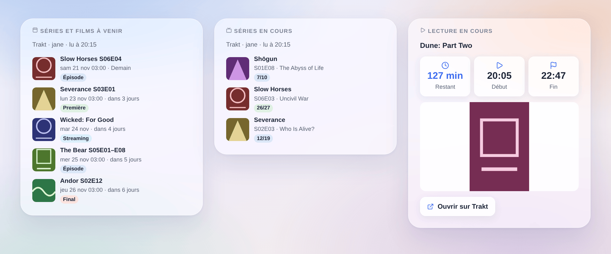

# Trakt

## Présentation

Cette intégration amène votre compte **Trakt** dans Gladys. Les épisodes des séries que vous suivez et les sorties des films de votre watchlist arrivent dans un **calendrier « Séries et films »** pour chaque utilisateur qui active l’intégration. Les scènes peuvent réagir le jour où un épisode est diffusé (ou la veille, ou une semaine avant), à la minute même de sa diffusion, quand une date change, et quand vous **commencez ou arrêtez de regarder** quelque chose sur Plex, Kodi, Jellyfin, Infuse ou les applis Trakt. Des actions de scène ajoutent un titre à votre watchlist ou le marquent comme vu, et trois widgets du tableau de bord montrent ce qui arrive, vos séries en cours et la lecture en cours, avec les affiches.

Tout vient de l’[API officielle de Trakt](https://developer.trakt.tv), avec votre propre app Trakt gratuite. Gladys Trakt utilise Trakt mais n’est ni approuvée ni certifiée par Trakt.

## Prérequis

- Gladys Assistant **5.3.0** ou plus récent (intégrations de calendrier).
- Un accès à Internet.
- Un compte [Trakt](https://trakt.tv) (le gratuit suffit) et un compte GitHub, que Trakt demande une fois pour vous laisser créer une app d’API.
- Pour « Lecture en cours » : un lecteur qui envoie ses lectures à Trakt (Plex, Kodi, Jellyfin, Emby, Infuse, les applis Trakt…), ou des check-ins.

## Configuration

1. Sur trakt.tv, ouvrez **Settings → My Apps** (la première fois, Trakt vous demande de relier un compte GitHub vérifié) et créez une app : nom libre, par exemple « Gladys », redirect URI `urn:ietf:wg:oauth:2.0:oob`. Copiez son **Client ID**. Aucun Client Secret n’est nécessaire.
2. Dans Gladys, collez le Client ID dans la configuration de l’intégration et **enregistrez**.
3. Cliquez sur **Connecter** : la page d’activation de Trakt s’ouvre. Connectez-vous à Trakt et saisissez le code affiché dans l’état de connexion de la page de configuration. Quelques secondes plus tard, l’état indique « Relié à <votre nom Trakt> ».
4. Dans **Mes calendriers** sur la même page, appuyez sur **Activer pour moi**. Chaque utilisateur qui veut le calendrier active l’intégration pour lui-même ; le compte Trakt est le même pour tous.

Trakt supprime une app inutilisée pendant 30 jours : laissez l’intégration tourner. Une app en développement (le cas par défaut) suffit pour vous et jusqu’à 16 personnes que vous y invitez.

| Champ                                   | Description                                                                                         |
| --------------------------------------- | --------------------------------------------------------------------------------------------------- |
| Client ID                               | Le Client ID de votre app Trakt (64 caractères). Il identifie l’app ; ce n’est pas un mot de passe. |
| Compte Trakt                            | Le bouton Connecter : relie le compte par un code saisi sur trakt.tv/activate.                      |
| Ce qu’il faut suivre                    | Épisodes de séries, sorties de films et sorties de films en streaming (les trois par défaut).       |
| Jours lus à l’avance                    | 30, 60 (par défaut) ou 90 jours.                                                                    |
| Garder les épisodes spéciaux            | Épisodes de la « saison 0 » (bonus, making-of). Désactivé par défaut.                               |
| Lecture en cours                        | Demande chaque minute à Trakt ce que le compte regarde. Activé par défaut.                          |
| Lecture du calendrier                   | Toutes les heures, 3 heures (par défaut), 6 ou 12 heures.                                           |
| Heure du déclencheur « jour de sortie » | De 0 à 23, heure locale (9 par défaut).                                                             |
| Langue des textes des scènes            | Langue des phrases prêtes et des messages des boutons. Automatique : la langue du tableau de bord.  |

Les boutons **Relire maintenant** et **Déconnecter le compte Trakt** sont en bas de la configuration. Après une déconnexion, révoquez aussi l’app dans vos réglages Trakt (Connected apps).

## Utilisation

### Calendrier

Chaque utilisateur reçoit un calendrier nommé « Séries et films » :

- un **épisode** est un événement à son heure de diffusion (convertie dans le fuseau de Gladys), aussi long que sa durée : « Severance S02E05 – Trojan’s Horse ». Une saison publiée d’un coup forme un seul événement : « Andor S02E01–E08 » ;
- une **sortie de film** et une **sortie en streaming** d’un film de votre watchlist sont des événements sur la journée.

Trakt liste les épisodes des séries que vous avez regardées ou gardées dans votre watchlist, et les films de votre watchlist. Le calendrier garde les 7 derniers jours et les jours lus à l’avance. Un épisode qui change de date suit ; une série retirée de votre watchlist disparaît.

Un nouveau calendrier est **privé**. Dans **Mes calendriers**, activez **Partager avec le foyer** pour l’utiliser dans les scènes du foyer (et avec le déclencheur natif « Un événement du calendrier arrive »), ou désactivez **Synchroniser ce calendrier** pour l’ignorer.

### Widgets du tableau de bord

- **Séries et films à venir** : les 3, 5 ou 8 prochains éléments avec jour, heure, délai, une pastille (première, final, type) et l’affiche. Touchez-en un pour ses détails et sa page Trakt. Il peut se limiter à certains types.
- **Séries en cours** : le prochain épisode à voir de chaque série suivie, et combien vous en avez vu.
- **Lecture en cours** : ce que le compte regarde, le temps restant, le début et la fin prévue, l’affiche ; sans lecture, le dernier titre regardé.

Les affiches sont téléchargées une fois et gardées par l’intégration (Trakt interdit de les charger depuis ses serveurs) : elles apparaissent un peu après la première lecture.

### Scènes

Déclencheurs (filtres : types, et titre de la série ou du film exactement comme Trakt l’écrit) :

- **Trakt : nouveau dans le calendrier** : un épisode ou un film est apparu dans les jours déjà lus (série renouvelée, nouvelle date, titre ajouté à votre watchlist sur trakt.tv).
- **Trakt : jour de sortie** : un épisode est diffusé ou un film sort aujourd’hui, demain ou dans une semaine (à choisir dans « Quand »), à l’heure de la configuration.
- **Trakt : un épisode est diffusé** : l’heure de diffusion d’un épisode vient de passer.
- **Trakt : date modifiée** : le jour ou l’heure d’un élément à venir a changé ; `previous_date` contient l’ancien jour.
- **Trakt : lecture commencée** et **Trakt : lecture arrêtée** : nécessitent « Lecture en cours ». « Arrêtée » indique si la fin a été atteinte (`finished`) et combien de minutes ont été regardées. Une pause compte aussi comme un arrêt, et la reprise comme un début.
- **Trakt : compte à relier** : Trakt refuse la connexion (app supprimée, accès révoqué) : cliquez de nouveau sur Connecter.

Les variables : `full_title` (« Severance S02E05 – Trojan’s Horse »), `title`, `episode` (« S02E05 »), `episode_title`, `kind` (episode, movie, streaming), `kind_name`, `season`, `number`, `premiere`, `finale`, `date`, `time`, `date_text`, `days`, `network`, `url`, `text` (une phrase prête).

Actions :

- **Trakt : prochain épisode ou sortie** : le prochain élément de votre calendrier (de certains types, ou d’un titre), avec jour, heure, jours restants et une phrase prête `text`.
- **Trakt : ajouter à la watchlist** : un film ou une série, par titre (« Dune (2021) »), identifiant IMDb ou adresse trakt.tv. Ses épisodes et sorties rejoignent ensuite le calendrier.
- **Trakt : marquer comme vu** : le prochain épisode d’une série en cours, ou un film. Un même titre n’est jamais marqué deux fois en une heure.

Exemples :

- Quand **la lecture commence** → baisser les lumières du salon et fermer les volets ; quand **la lecture s’arrête** avec `finished` = true → rallumer les lumières.
- Quand **un épisode de Severance est diffusé demain** → envoyer `{{triggerEvent.data.text}}` sur Telegram à 9 h.
- Quand **quelque chose de nouveau apparaît dans le calendrier** → envoyer `{{triggerEvent.data.full_title}}, {{triggerEvent.data.date_text}}` et le lien `{{triggerEvent.data.url}}`.

### Transport

Cloud uniquement. L’intégration parle à l’API de Trakt et télécharge les affiches depuis les serveurs de Trakt. Votre Client ID et vos jetons Trakt ne vont qu’à Trakt. Rien sur votre maison ne quitte votre réseau : Trakt ne reçoit que ce qu’écrivent les actions de scène (watchlist, historique).

## Dépannage

- **Connecter dit que Trakt ne connaît pas ce Client ID** : recopiez le Client ID depuis Settings → My Apps (pas le Client Secret), enregistrez, puis cliquez sur Connecter.
- **Le code a expiré** ou **a été refusé** : cliquez de nouveau sur Connecter et saisissez le nouveau code dans les 10 minutes.
- **« Trakt refuse la connexion : cliquez de nouveau sur Connecter »** : l’accès a été révoqué sur trakt.tv, l’app a été supprimée (inutilisée pendant 30 jours), ou Gladys est restée éteinte longtemps. Reconnectez-vous ; si l’app n’existe plus, créez-en une autre et collez son Client ID.
- **« Trakt refuse le Client ID »** : l’app a été supprimée ou attend une approbation ; vérifiez-la dans My Apps.
- **Le calendrier reste vide** : vérifiez que vous avez appuyé sur **Activer pour moi** dans Mes calendriers, et que le compte suit des séries (regardées ou dans la watchlist) avec des épisodes dans les jours à venir.
- **Les heures sont décalées d’une heure** : ce sont les heures de la première diffusion de l’épisode, dans le fuseau de Gladys (Paramètres → Système). Certains services de streaming publient à une autre heure dans votre pays.
- **« Lecture en cours » ne change jamais** : votre lecteur doit envoyer ses lectures à Trakt (vérifiez qu’elle apparaît en « watching now » sur trakt.tv) ; l’option doit être activée.
- **« Trakt demande de ralentir »** : les requêtes reprennent à l’heure affichée ; rien n’est perdu.
- **Pas d’affiche** : les affiches sont téléchargées après une lecture ; certains titres n’en ont pas sur Trakt.

Pour signaler un bug, indiquez les versions de Gladys et de l’intégration, vos lecteurs, et les lignes de l’onglet Journaux de l’intégration ; en mode développeur, `DEBUG=gladys-integration-sdk` ajoute les journaux du SDK.
